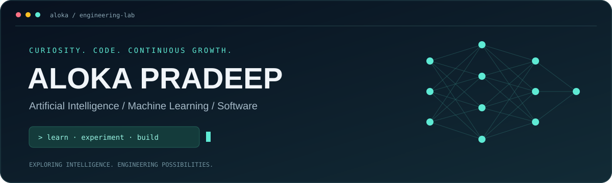
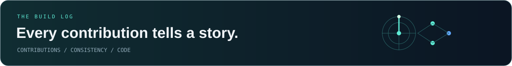
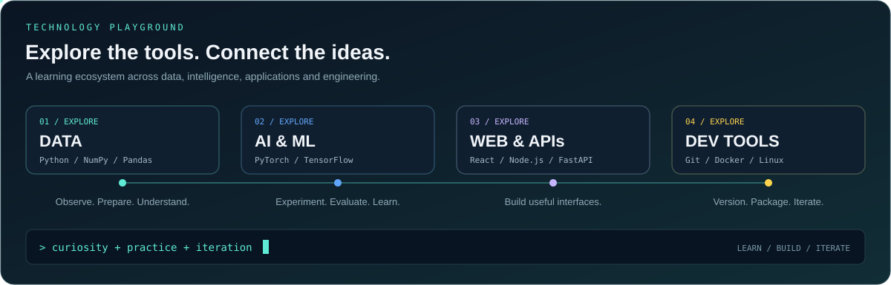

<!--
ALOKA PRADEEP / NEURAL TERMINAL EDITION
Replace ALL occurrences of YOUR_GITHUB_USERNAME with your exact GitHub username.
Upload README.md plus assets/ and .github/ from the accompanying ZIP.
Use a public repository whose name matches your GitHub username for a profile README.
See SETUP.md for contribution animation setup. No personal token is required.
LinkedIn is linked; certification data is not automatically imported.
-->

<div align="center">



<br /><br />


<p>
<a href="https://www.linkedin.com/in/aloka-pradeep-644251238/"></a>
<a href="https://github.com/YOUR_GITHUB_USERNAME?tab=repositories"></a>
</p>

<sub><b>LEARN WITH CURIOSITY &nbsp; / &nbsp; BUILD WITH PURPOSE</b></sub>

</div>

<br />

## 01 / The Person Behind the Code

I'm **Aloka Pradeep**, exploring how **Artificial Intelligence**, **Machine Learning** and **Software Engineering** come together to create useful products. I enjoy understanding problems, experimenting with ideas and learning by building.

```python
aloka = {
    "focus": ["AI Engineering", "Machine Learning", "Software Engineering"],
    "exploring": ["Deep Learning", "NLP", "Computer Vision", "Generative AI"],
    "process": "Understand → Experiment → Evaluate → Improve",
    "goal": "Build useful technology with thoughtful engineering."
}
```

<table>
<tr>
<td width="50%" valign="top">
<h3>🧠 Intelligence &amp; Data</h3>
<p>Learning how models discover patterns and how to evaluate what they actually learn.</p>
<p>Machine Learning · Deep Learning<br />NLP · Computer Vision · Generative AI</p>
</td>
<td width="50%" valign="top">
<h3>⚙️ Systems &amp; Software</h3>
<p>Exploring the engineering that turns an experiment into a practical application.</p>
<p>Full-stack Development · APIs<br />Databases · Testing · Deployment</p>
</td>
</tr>
</table>


## 02 / GitHub Activity

<div align="center">



<br /><br />

<a href="https://github.com/YOUR_GITHUB_USERNAME?tab=overview"></a>

<br /><br />


<br /><br />


<br /><br />

### 🐍 Contribution Snake


<br /><br />

<a href="https://github.com/YOUR_GITHUB_USERNAME?tab=overview"></a>

<br /><br />

<sub>Activity cards may be cached. Language statistics describe repository code, not proficiency.</sub>

</div>

<!-- The included Action replaces the setup image with your actual contribution snake.
Upload the .github folder and run Update contribution snake from the Actions tab.
The README above does not display fabricated contribution data. -->

<br />


## 03 / Machine Learning Notebook

**Learning interests, from the data foundations to the application layer.**

| Track | What I'm exploring |
| :--- | :--- |
| **01 · Data** | NumPy, Pandas, exploratory analysis, data quality and visualization |
| **02 · Classical ML** | Regression, classification, clustering and feature engineering |
| **03 · Deep Learning** | Neural networks, optimization and transfer learning |
| **04 · Language & Vision** | Text classification, embeddings, transformers and image models |
| **05 · Generative AI** | LLM applications, retrieval-augmented generation and grounded answers |
| **06 · Evaluation** | Baselines, validation, error analysis and leakage prevention |
| **07 · Delivery** | Model APIs, reproducible experiments and useful interfaces |

<details>
<summary><b>Open my experiment checklist</b></summary>

<br />

- Define the problem and a useful success metric.
- Understand the dataset and its limitations.
- Establish a simple baseline before adding complexity.
- Separate training, validation and test data appropriately.
- Track experiments and inspect failure cases.
- Document results and build a reproducible application.

</details>

<br />

## 04 / Technology Playground



<br />

<div align="center">

<sub>Tools and ecosystems I'm interested in learning and experimenting with.</sub>

#### Languages & Foundations


#### Machine Learning & Deep Learning


<br /><br />


#### Web & API Development


#### Databases & Developer Tools


</div>

<br />


## 05 / Ideas on My Radar

*Project directions I'd like to explore as I learn.*

| Idea | Engineering question |
| :--- | :--- |
| **Document Q&A** | How can retrieval help an assistant answer from evidence? |
| **Prediction Dashboard** | How can a model's results become understandable and useful? |
| **Vision Application** | How can transfer learning support a practical image task? |
| **Text Analysis API** | How can an NLP experiment become a reliable service? |

<br />

## 06 / Certifications & Connections

<div align="center">

<p>Find my professional updates and certification information on LinkedIn.<br />Interested in AI, Machine Learning or Software? Let's exchange ideas.</p>

<a href="https://www.linkedin.com/in/aloka-pradeep-644251238/"></a>

<br /><br />


<br />

<sub><b>ALOKA PRADEEP</b> &nbsp; / &nbsp; AI · ML · SOFTWARE</sub>

</div>


